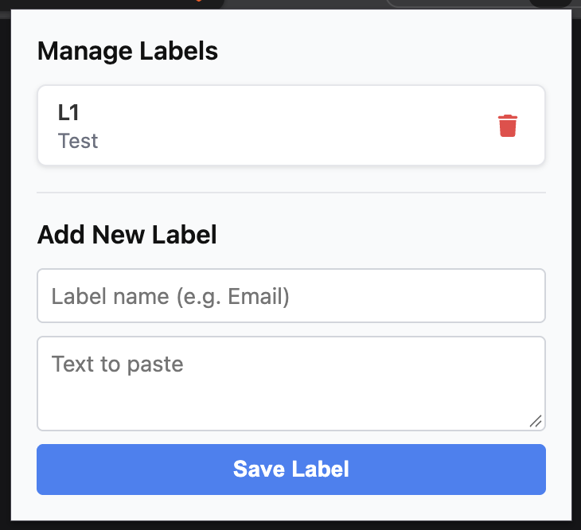

# Label Paste 

**Label Paste** is a simple, highly effective browser extension that makes you more productive by allowing you to save frequently used text snippets and quickly paste them directly from your right-click context menu.

## Why is this useful?
Are you tired of typing the same email addresses, signatures, generic replies, or code snippets over and over? This extension eliminates repetitive typing. 

With **Label Paste**, you can:
- **Save time and boost productivity**: Create custom labels for your most-used texts.
- **Quick Access**: Just right-click on any input field, text area, or rich text editor, and select your saved label to instantly paste the text.
- **Easy Management**: Use the extension popup to seamlessly add, view, and delete your saved labels.

## Installation (Step-by-step)

To install this extension locally in Google Chrome or any Chromium-based browser (like Edge or Brave), follow these steps:

1. **Get the files**
   Ensure you have the `label-paste` folder on your computer containing all the extension files (like `manifest.json`, `background.js`, etc.).

2. **Open the Extensions Page**
   Open your browser and navigate to `chrome://extensions/` in the address bar.

3. **Enable Developer Mode**
   In the top right corner of the Extensions page, toggle the **Developer mode** switch to **ON**.

4. **Load Unpacked Extension**
   Click the **Load unpacked** button that appears in the top left area.

5. **Select the Folder**
   Browse to the `label-paste` directory on your computer and select the folder. 

6. **You're Done!**
   The **Label Paste** extension will now be active. Pin the extension to your toolbar, click the "LP" icon to add your first label, and right-click on any text box on a webpage to paste it!
